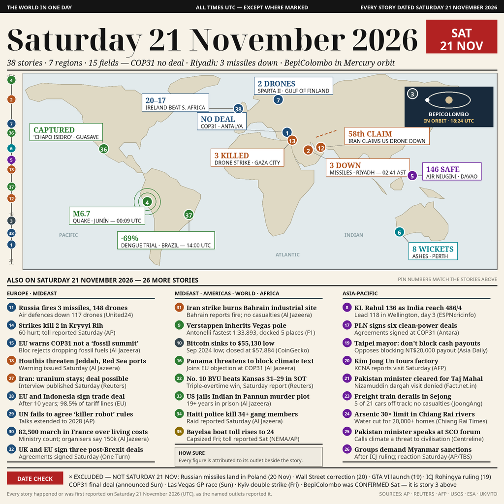

# Saturday 21 November 2026 — 38 dated stories, 7 regions



One image that sums up the world's news of Saturday 21 November 2026:
**38 stories, 7 regions, 15 fields** — COP31 no deal, Riyadh: 3 missiles
down, BepiColombo in Mercury orbit.

## How it reads

- **The map is the hero.** The top half of the image is one large world map;
  the 12 biggest stories sit on it as numbered pins, each with a big number
  and a 2–4 word verdict baked into its label (NO DEAL · 3 DOWN · IN ORBIT ·
  CAPTURED · M6.7 · −69% · 20–17 …). There is no small footer map.
- **The other 26 stories are three region columns** (Europe · Mideast ·
  Africa / Mideast · Americas · World / Asia-Pacific · Oceania) in 12–13 px
  type — no tiny numbered list anywhere on the page.
- **A vertical UTC rail on the left edge** ties every map story to its hour
  (00:09 Peru quake · 02:41 Riyadh missiles · 05:50 Sparta II · 14:00
  Wolbachia · 18:24 BepiColombo · 22:10 COP31 pause), so the day reads as a
  sequence from night to night.
- **DATE CHECK** at the bottom excludes, by name, the well-known stories that
  belong to another day (20 Nov and earlier, plus Sunday's news).

Every story happened, or was first reported, on Saturday 21 November 2026
(UTC), as the named outlets reported it. Claims are attributed; the Iran
drone claim is labelled a claim.

## Reproduce

```sh
python3 render.py entry.png   # draws entry.png, 1024x1024, deterministic
python3 main.py               # copies entry.png to $MAKEFUN_OUTPUT_DIR
```

`render.py` draws everything procedurally with Pillow (Noto Serif / Noto
Sans, SIL OFL). No external assets, no network, no randomness: two runs
write byte-identical PNGs.

## License

MIT — see LICENSE.
